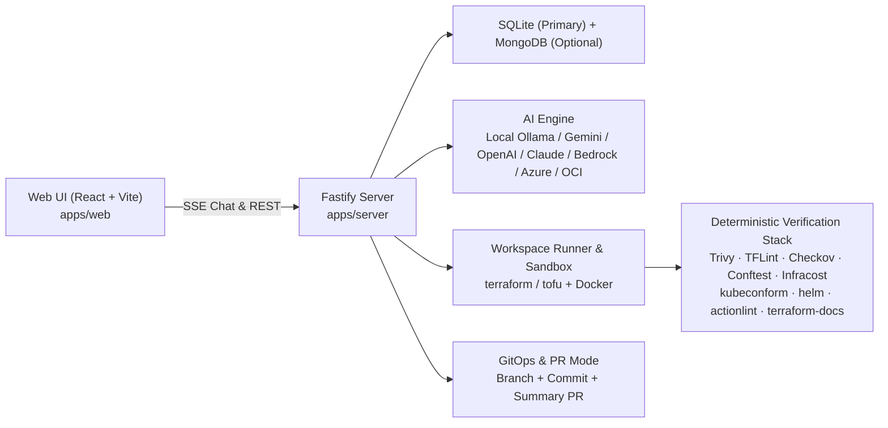

# AutoDevOps AI (TerraMind)

Welcome to **TerraMind**, your dedicated, self-correcting AI Cloud & Platform Architect. TerraMind combines a React + Vite web interface, a Fastify + TypeScript backend, SQLite/MongoDB persistence, and real deterministic DevOps CLI tooling via Model Context Protocol (MCP) integrations.

## Architecture



## Repository Layout

* `apps/server/` — Fastify TypeScript backend (`src/server.ts`, `src/routes/`, `src/services/`, `src/db/`, `src/tests/`).
* `apps/web/` — React + Vite frontend (`src/App.tsx`, `src/components/`, `src/hooks/`).
* `.agents/skills/agentic/` — Canonical Agentic design system skill.
* `Workspace/` — Default local IaC workspace directory (falls back to `Terraform/` if already present) where generated `.tf`, Kubernetes YAML, Helm charts, and CI/CD pipelines are written and verified.
* `install-tf-ai.sh` & `install-tf-ai.ps1` — One-shot installers for Linux/macOS and Windows.
* `start-terramind.sh` — Startup script for Linux/macOS.

## 4 Specialized DevOps Agents

1. **Terraform DevOps Expert (`agent_tf-devops-expert`)**: Designs modular, secure, and validated Terraform / OpenTofu code across 4 architectural strategies (Flat, Module-Based, Environment + Modules, Layer-Based), backed by `fmt`, `validate`, `tflint`, `trivy`, `checkov`, `conftest`, `terraform-docs`, and live provider schemas.
2. **FinOps & Cloud Cost Optimizer (`agent_finops-cost-optimizer`)**: Multi-cloud cost comparisons (AWS vs GCP vs Azure), Spot/Graviton rightsizing, and deterministic monthly cost breakdowns via `infracost`.
3. **Kubernetes & GitOps Platform Engineer (`agent_k8s-gitops-architect`)**: Workload-tailored manifests, resource QoS, probes, network policies, Helm charts, and ArgoCD/Flux GitOps rollouts validated with `kubeconform`, `helm lint`, and `trivy config`.
4. **CI/CD Pipeline Engineer (`agent_cicd-pipeline-engineer`)**: Multi-stage GitHub Actions & GitLab CI pipelines with OIDC keyless auth, state locking, and automated validation via `actionlint`, `checkov`, and `trivy`.

## Quick Start

```bash
# Install workspace dependencies
npm install

# Run development server (backend + frontend)
npm run dev

# Build all workspaces
npm run build

# Run server test suite
npm test
```

Or use the one-liner installers:

**Windows (PowerShell):**
```powershell
irm https://raw.githubusercontent.com/TerraMindLabs/TerraMind/main/install-tf-ai.ps1 | iex
```

**Linux / macOS:**
```bash
bash -c "$(curl -fsSL https://raw.githubusercontent.com/TerraMindLabs/TerraMind/main/install-tf-ai.sh)"
```

## License

Licensed under the [ISC License](./LICENSE).
